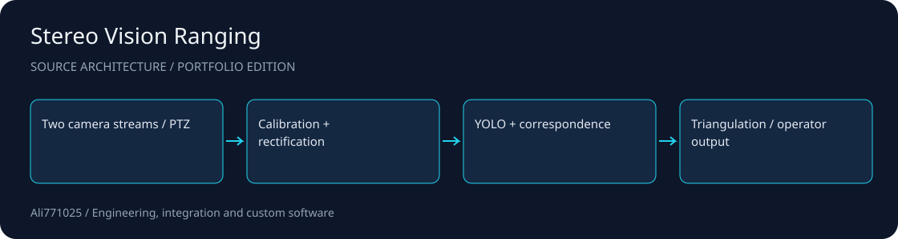

# Stereo Vision Ranging

**Calibrated dual-camera vision with conservative object matching, ranging and PTZ-aware tracking.**

Computer vision · Python · Camera integration · 3D geometry

[راهنمای فارسی](docs/README.fa.md) · [Architecture](docs/ARCHITECTURE.md) · [Discuss a project](https://github.com/Ali771025)

## What this demonstrates

- Axis VAPIX / RTSP acquisition, diagnostics and frame freshness checks.
- Stereo calibration, rectification, correspondence checks and triangulation.
- YOLO integration, manual/evaluated measurement and PTZ-aware tracking tooling.

## Source map

| Path | Responsibility |
| --- | --- |
| `axis_stereo/axis.py` | Camera integration |
| `axis_stereo/calibration.py` | Calibration |
| `axis_stereo/geometry.py` | Geometry |
| `axis_stereo/runtime.py` | Detection and output |

## Setup and integration

Install Python and `requirements.txt`; provide compatible local Ultralytics weights in the model path yourself. Copy `config.example.yaml` to a private config, replace documentation-only camera hosts, and set camera credentials using the environment-variable names in that config. Use `python -m axis_stereo --help` to inspect available commands. Complete real camera calibration and independent reference measurements before relying on metric outputs; no private calibration or camera data is published.

## Scope and evidence

Camera hosts are RFC 5737 documentation addresses. Hardware availability, GPU throughput, synchronization and field accuracy are unverified in this publication. Missing or unreliable matches should produce unavailable range, rather than fabricated values. Ultralytics, weights, OpenCV and other dependencies retain their own licensing requirements.

This public portfolio edition contains selected source and integration manifests. Contracts, private data, customer materials, original Git history, dependency trees and large assets are excluded. No tests, builds or application runs were performed for this publication; no previous result is presented as a current validation.

## Work with me

I am available for projects involving Computer vision, Python, Camera integration, 3D geometry. For a useful first discussion, share the problem, target environment, expected deliverables and acceptance criteria. I can help scope an implementation, integration or improvement around your constraints.

Contact: [Ali771025 on GitHub](https://github.com/Ali771025). Please share confidential material through an agreed private channel.

## Rights and dependencies

Publication for portfolio review does not grant a new blanket license. Existing file notices and dependency terms continue to apply. Contact the author to agree terms for reuse or a commercial engagement.
