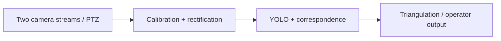

# Stereo Vision Ranging architecture

The diagram describes the source responsibilities, not a measured production deployment.

| Module | Responsibility |
| --- | --- |
| `axis_stereo/axis.py` | Camera integration |
| `axis_stereo/calibration.py` | Calibration |
| `axis_stereo/geometry.py` | Geometry |
| `axis_stereo/runtime.py` | Detection and output |

Camera hosts are RFC 5737 documentation addresses. Hardware availability, GPU throughput, synchronization and field accuracy are unverified in this publication. Missing or unreliable matches should produce unavailable range, rather than fabricated values. Ultralytics, weights, OpenCV and other dependencies retain their own licensing requirements.
